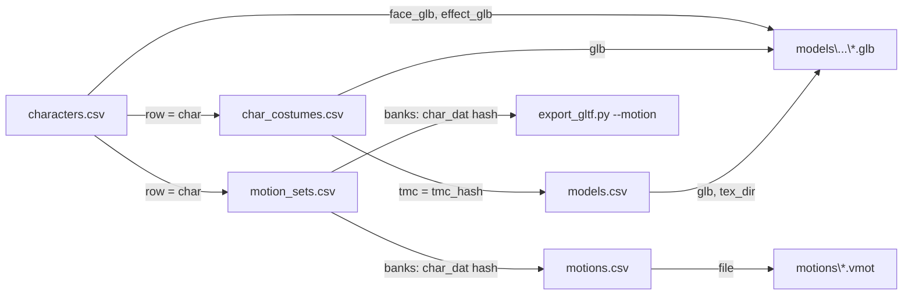

# DOAXVV（DMM）资源解包阶段性总结

本文记录当前仓库已经确认的事实。第一版写于 2026-11-24；2026-11-26 版补上了全部密钥规则、`TMCL` 外部数据、骨骼、贴图解码和 glTF 导出；本版（2026-11-27）补上骨骼动作（`char_dat`，第 10 节）和全量导出结果。没有在本机复核过的推测，单独放在文末「尚未确认」一节。

客户端只读，不修改 `E:\Games\DMM\DOAX-VenusVacation`，也不修改 `D:\Projects\YangHui\VVPrism`。

## 1. 结论

哈希文件基本都能解开了。`index.csv` 共 **40832** 个文件，只剩 **88** 个没有归类，其中 76 个是几 KB 的小明文表，12 个小于 16 字节；真正认不出的只有 2～3 个。

人物模型已经能完整导出：网格、法线、切线、多套 UV、蒙皮权重、骨骼层级、绑定姿态和贴图，输出为 glTF 2.0（`.glb` + PNG）。美咲 `KAS_MIS_za_16_a` + `MIS_hair_00` + 脸已经在 Blender 里合体渲染核对过（见第 9 节）。

旧版里卡住的两件事，原因都找到了：

1. 旧索引只穷举 2、3 字节短密钥。大文件的短密钥是 4 字节，而且短密钥由「解压后的总长度」决定（第 5.1 节）。
2. 第 7 节那 3427 个 `4A 7B` 大文件不是顶点缓冲，而是场景用的 IBL 立方体贴图。人物真正的顶点、索引和贴图在另一类文件 `TMCL` 里（第 6.3 节）。

骨骼**动画**也解开了：动作在 `char_dat` 里，关键帧编码已从 exe 里还原。身体动作已经能写进 `.glb` 作为 glTF animation，并在 Blender 里核对过（第 10 节）。`clip` 是 UV / 材质动画，不是骨骼动作。

全量导出：3113 个 `TMC` **全部**导出成功。其中 744 个有多个同长度 `TMCL` 候选，按排名选取（第 6.4 节）。表情动作也已经能套到脸上；身体、手、胸部动作可以按剪辑帧数自动配对（第 10.6 节）。

## 2. 和 VVPrism 不是同一套布局

`D:\Projects\YangHui\VVPrism` 是 Steam 版 *Venus Vacation PRISM* 的旧工具，只能当参考，不能把那边的目录和编号套到 DMM 版上。

| | PRISM（Steam） | DOAXVV（DMM，本仓库） |
|---|---|---|
| 包索引 | `root.rdb` / `root.rdx` | 没有这套索引。文件名本身是 64 位十六进制 |
| 内容块 | `.fdata`，zlib 块大小 16384 | 哈希文件解密后也是 zlib 页，常见解压长度 16384，但外层加密不同 |
| 模型 | `G1M`，魔数 `_M1G9300` | `TMC`（描述）+ `TMCL`（顶点、索引、贴图） |
| 贴图 | `G1T` / `GT1G` | `TMCL` 里内嵌的 `DDS`，绝大多数是 BC7 |
| 着色器 | — | `_S2G3000`，里面是 DXBC / HLSL |

本版 exe 里没有把 `_M1G` 当作资源魔数使用。不要用 PRISM 的 ktid、版本号 `9300` / `5400`，或身体编号 `0x7ce546e8` 去对 DMM 文件。

## 3. 游戏目录

根目录：`E:\Games\DMM\DOAX-VenusVacation`

```
DOAX_VV.exe
DOAX_VV_Launcher.exe
DX11_data\
    COMMON\          19236 个哈希文件
    HIGH\            12342 个哈希文件
    DL\COMMON\        6818 个哈希文件
    DL\HIGH\          2436 个哈希文件
```

（`DL` 两个目录比第一版多了 23 个文件，是客户端更新带来的。）

`COMMON` 与 `HIGH` 的文件名没有交集。`DL` 是追加内容，结构与对应的 `COMMON` / `HIGH` 相同。

当前 exe：

- 大小 **65,716,120** 字节
- 时间戳 **2026-11-20 20:40:31**
- 引擎字符串：`KTGL For DX11(x64)`
- 首选映像基址 `0x140000000`，实际加载基址随 ASLR 变化
- 读内存时进程为 `DOAX_VV.exe`，必须从 DMM 客户端启动。普通权限 `OpenProcess` 会返回拒绝访问，需要提升权限

文件名规则：

- 64 个十六进制字符，没有扩展名
- 不是文件内容的 SHA-256
- 也不是资源名（例如 `s_MIS_HAIR_00`）的 SHA-256
- 进程里看不到 `COMMON\<哈希>` 这种路径。游戏通过档案对象读数据，不按这个路径字符串去 `CreateFile`

## 4. 本仓库

```
D:\Projects\YangHui\DOAXVV\
    index.csv               全库索引（正式结果）
    阶段总结.md             本文
    tools\
        decrypt.py          解密一个哈希文件，自动恢复短密钥
        build_index.py      重建 index.csv（多进程）
        tmc.py              TMC / TMCL 解析
        bcdec.py            纯 numpy 的 BC7 / DDS 解码和 PNG 写出
        export_gltf.py      TMC + TMCL → .glb + PNG，可带动作
        motion.py           char_dat 动作解析；命令行列出某个文件里的动作
        survey_motion.py    普查全部 char_dat，写 out\motions.csv
        export_motion.py    把 char_dat 转成预览程序读的 out\motions\<哈希>.vmot（第 13.4 节）
        pair_motion.py      按剪辑帧数给身体 / 手 / 胸部动作配对，写 out\motion_sets.csv
        archive_dir.py      解析根目录，写 out\archive_dir.csv
        chr_data.py         解析角色 / 服装 / 动作表，写 out\chr_data\、tmc_pairs.csv
        cdn_fetch.py        从官方 CDN 下载缺失的服装、发型、脸、动作文件到 cdn\（更新流程见 4.3）
        layout.py           输出目录规则（部件类型、组、贴图文件夹）
        char_costumes.py    按角色列出服装、发型和对应的 glb，写 out\catalog\char_costumes.csv
        organize_out.py     重写 out\catalog\ 下的关系表
        restore_out.py      一次性迁移：把旧的 md5 贴图库 out\lib\ 还原成按模型存放
        check_glb.py        检查导出的 .glb（索引、骨骼下标、权重和）
        blender_preview.py  用 Blender 后台渲染预览图
        rdc_dump.py         用 qrenderdoc 导出 RenderDoc 抓帧的绘制、着色器、贴图、渲染目标（第 14 节）
        rdc_match.py        把抓帧里的绘制对上导出的 glb 子网格、贴图槽位、MtrCol（第 14 节）
        _seed_live.bin      从运行中的游戏读出的 344 字节种子
        其余 .py / .bin / .txt
                            排查过程里的脚本和转储，不是稳定接口
    viewer\                 模型预览程序（C++ / SDL3 / D3D11，第 13 节）
        src\  shaders\      源码和 HLSL（运行时编译，改了自动重载）
        third_party\        SDL3、Dear ImGui、cgltf、stb_image、renderdoc_app.h 的完整源码
        build\              构建输出（已在 .gitignore 里）
    cdn\                    CDN 下载的服装文件（已在 .gitignore 里）
    out\                    导出结果（已在 .gitignore 里）
        models\             导出的模型和贴图（第 4.2 节）
        motions\            导出的动作 .vmot（export_motion.py）
        renderdoc\<抓帧名>\  rdc_dump.py / rdc_match.py 的输出
        catalog\            角色、服装、模型、动作之间的对应表（第 4.2 节）
        chr_data\           主数据库各节的原始解析结果（chr_data.py）
        chr_characters.csv  chr_data.py 的角色表，catalog\characters.csv 由它生成
        tmc_pairs.csv       官方 TMC → TMCL 配对
        archive_dir.csv     档案目录：哈希 → 目录类型、CDN 版本号
        motions.csv         每个 char_dat 里的动作：根骨骼名、节点数、剪辑数
```

Python 工具的依赖只有 Python 3 + numpy，没有用第三方 glTF / 贴图库；`rdc_match.py` 另外用 Pillow 比较贴图，`rdc_dump.py` 需要 RenderDoc 1.47（`C:\Program Files\RenderDoc`）。预览程序的第三方库都以源码放在 `viewer\third_party\`，不需要 vcpkg（第 13 节）。

### 4.1 游戏怎么组织模型，输出就怎么组织

- **一个部件 = 一个 TMC + 它自己的 TMCL。**
  - TMC 里存网格、材质、骨骼节点、蒙皮。
  - TMCL 里存这个部件的全部贴图（完整 DDS）、顶点和索引。
  - 游戏没有共享贴图库：同一张贴图被几件泳装用到，每件泳装的 TMCL 里各存一份。颜色变体（`_a`/`_c`）的 TMC 相同，TMCL 不同。
  - 所以输出也是一个模型一份 glb，旁边放它自己的 `<模型>_tex\`。`NN.png` 的 NN 就是贴图在 TMCL 里的顺序，glb 里还记在 `images[].extras.tmcl_texture`。
- **部件按档案目录的类型分开**（「10.5 档案目录」），输出第一层就用这个类型：

| 目录类型（TMC/TMCL） | 输出文件夹 | 内容 |
|---|---|---|
| 25/26 | `costume` | 服装。**身体皮肤和泳装在同一个模型里**（`WGT_body`、`WGT_body_brk`、`WGT_mizugi`、`WGT_mizugi2` 等），带完整骨架，约 385 个节点 |
| 17/18 | `hair` | 发型：`WGT_hair`、发饰，约 116 个节点 |
| 19/20 | `face` | 脸：`WGT_face`、`WGT_faceparts`、汗、阴影，约 59 个节点 |
| 53/54 | `accessory` | 饰品：`fac_*` 脸、`hea_*` 头、`wri_*` 手腕等 |
| 80/81 | `prop` | 道具、家具 |
| 27/28 | `stage` | 舞台、场景 |
| 39/40 | `effect` | `chr_xxx`，只是一个发光特效（`circle_004_glow`），不是身体 |
| 其他（如 23/24） | `misc` | 目前没有导出到这里的模型 |

- **第二层是组**：名字第二段如果是三个大写字母就用它（`KAS_MIS_za_16_a` → `MIS`，`KAS_OWN_bi_00_a` → `OWN`），否则用第一段（`MIS_hair_00` → `MIS`，`brd_ags_00_a` → `brd`）。名字第一段的 `KAS`/`HON`/`MAR` 是体型组，不是角色。重名模型在名字后加 `__<哈希前 8 位>`。
- **骨骼没有单独的文件。** 所有身体共用一套标准骨架，每个 TMC 自带用到的节点。头发和脸的顶点在 `MOT01_Head` 空间里，按骨骼名挂到身体上。角色之间的体型差异由 `chr_data` 的 `scale`、`skeleton` 两节控制。动作是每个角色自己的 `char_dat` 包（第 10 节，`mot` 表）。
- **"角色有哪些衣服"只记在 `chr_data` 表里**（「10.6 主数据库和官方配对」），不靠文件夹表达：
  - `chrall` 行引用脸（19/20）、特效（39/40）、动作包、`CostumeM`/`ChrMisc` 等。
  - `cos` 行引用服装 TMC/TMCL（25/26）、`tdpack`（51）、`ColorLis`（84）。
  - `hair` 行引用发型（17/18）。
  - 同一件 `OWN` 泳装在游戏里只存一份，被多个角色的 `cos` 行引用。对应地，输出也只导一份，角色到 glb 的关系写在 `out\catalog\char_costumes.csv`，脸和特效写在 `characters.csv`。

`python tools\organize_out.py` 会重写 `out\catalog\` 下的表。表里的路径都相对于 `out\`。

### 4.2 导出目录和对应关系

**目录**（数量是目前的导出结果，共 4114 个 TMC）：

```
out\models\
    costume\<组>\                 服装 1569 个，每个都是身体 + 泳装
        MIS\KAS_MIS_za_16_a.glb
        MIS\KAS_MIS_za_16_a_tex\00.png … 18.png
        OWN\KAS_OWN_bi_00_a.glb   OWN 组 1132 个，多数是多名角色共用的泳装
        HON\  KAS\  MAR\  …       其余按名字第二段分组
    hair\<角色>\                  发型 389 个
        MIS\MIS_hair_00.glb + MIS_hair_00_tex\
    face\                         脸 33 个
        misc\_S_face_test_00__bbcc0816.glb   游戏内名 *S_face_test_00，海咲用的那一份
        NOZ\NOZ_face_00.glb
    accessory\<前缀>\             饰品 1365 个：fac 脸 351、hea 头 250、wri 手腕 188、gra 441、rsys 64 …
    prop\<前缀>\                  道具 / 家具 584 个：spfn、witm、mdfn、wall …
    stage\<场景>\                 舞台 67 个：VNK0、GFO0 …
    effect\<前缀>\                特效 107 个：chr\chr_mis.glb 等
out\motions\                      动作 1476 个，共 3.1 GB：<char_dat 哈希>.vmot
out\catalog\
    models.csv  characters.csv  char_costumes.csv  motion_sets.csv  motions.csv  pairing.csv
```

**文件命名：**

- glb 文件名就是 TMC 里的资源名。Windows 不允许的字符换成 `_`，比如脸的内部名 `*S_face_test_00` 变成 `_S_face_test_00`。这类名字没有组可取，所以放在 `face\misc\`。
- 不同 TMC 同名时，排在后面的加 `__<哈希前 8 位>`，比如 `_S_face_test_00__bbcc0816`。哪个角色用哪一份，看 `characters.csv` 的 `face_glb`。
- 同一个哈希同时在游戏目录和 `cdn\` 里时，只导出游戏目录那份，名字不加后缀。
- `<模型>_anim.glb` 是用 `--motion` 带动作导出的同一个模型，贴图在它自己的 `<模型>_anim_tex\`。
- `<模型>_tex\NN.png` 只属于这一个模型。NN 是贴图在 TMCL 里的顺序，glb 的 `images[].extras.tmcl_texture` 里也记着；材质用到哪几张、各是什么槽位，在 `materials[].extras.textures` 里（槽位含义见第 8 节）。加 `--dds` 导出时，旁边还有原始的 `NN.dds`。

**对应表**（`out\catalog\`，utf-8 带 BOM，Excel 可以直接打开）：

| 表 | 一行是什么 | 主要的列 |
|---|---|---|
| `models.csv` | 一个 TMC（4114 行） | `tmc_hash` 主键；`name` 资源名；`out_name` 文件名；`category`、`group` 两层目录；`dir_type` 档案目录类型；`source` 来自 `game` 还是 `cdn`；`tmcl_hash` 和 `pairing`（`official` 官方配对，`guess` 按大小猜的）；`glb`、`tex_dir` 路径；`textures`、`meshes`、`materials` 数量；`glb_bytes` |
| `characters.csv` | 一个 `chrall` 行（34 行：33 个角色各一行，加上没有脸的默认行 `row 0`，`id 0002effe`） | `row` 角色序号；`char_id`；`code`（`mis`、`kas` …）；`face_tmc`、`face_name`、`face_glb` 脸；`effect_tmc`、`effect_name`、`effect_glb` 特效 |
| `char_costumes.csv` | 角色表里的一个 `cos` 或 `hair` 行（22105 行） | `char`（= `characters.csv` 的 `row`）；`code`；`kind`（`cos` 服装 / `hair` 发型）；`id`、`number` 表里的编号；`tmc`、`tmcl` 哈希；`tmc_name`；`local`（`no` 表示还没下载）；`glb` |
| `motion_sets.csv` | 一个 `mot` 行，即游戏里一起播放的一组动作 | `char`（= `characters.csv` 的 `row`）；`id`；`banks` 是空格分隔的几个哈希；`kinds` 是对应的 `body`/`face`/`hand`/`?`。`?` 的哈希不是 `char_dat`（是别的类型的文件），`motions.csv` 里没有 |
| `motions.csv` | 一个导出的 `char_dat`（1476 行，`export_motion.py` 写） | `hash` 主键（= `motion_sets.csv` 的 `banks` 里的哈希）；`kinds` 每个动作组的种类（`body`/`hand`/`face`/`breast`/`root`/`other`）；`banks`、`clips`、`frames` 数量；`bytes`；`file` 路径 |
| `pairing.csv` | 一次 `export_gltf.py --all` 里的一个 TMC | `tmc_hash`、`tmcl_hash`、`tmcl_matches`、`result`（`ok …` 或错误原因） |

几张表之间靠哈希和角色序号连起来：



**例：海咲（`mis`）的全部模型**

1. `characters.csv` 里 `code = mis` 的那行：`row = 10`，脸是 `models/face/misc/_S_face_test_00__bbcc0816.glb`，特效是 `models/effect/chr/chr_mis.glb`。
2. `char_costumes.csv` 里 `code = mis`：
   - `kind = cos` 共 479 行，涉及 340 件不同的服装，其中 339 件已导出（剩下 1 件 `local = no`）。同一件服装可能出现在多行。`glb` 列就是文件，比如 `models/costume/MIS/KAS_MIS_za_16_a.glb`。
   - `kind = hair` 共 12 行，比如 `models/hair/MIS/MIS_hair_00.glb`。
3. `motion_sets.csv` 里 `char = 10` 的行（928 行）列出她的动作组合。每个 `char_dat` 哈希在 `motions.csv` 里查到 `out\motions\<哈希>.vmot`，预览程序直接读它（第 13 节）。要给别的软件用，可以用 `export_gltf.py --name <服装> --motion <char_dat 哈希前缀>` 把动作烘进 glb（第 10 节「10.6 导出」）。
4. 一套完整的角色由 服装 glb + 发型 glb + 脸 glb 组成，可能再加饰品。三者各自带着同名的标准骨骼（第 4.1 节）。要合成一个角色，就把头发和脸绑到服装骨架的同名骨骼上，主要是 `MOT01_Head`。

反过来查"这件泳装有哪些角色能穿"：在 `char_costumes.csv` 里按 `tmc_name` 或 `glb` 过滤，看 `code` 列。例如 `KAS_MIS_za_16_a` 出现在 `kas`、`kok`、`mis`、`pty`、`rik`、`tin` 六个角色的 `cos` 表里。

### 4.3 游戏更新后：重新下载和导出

**前提：**
- 先用 DMM 启动器把游戏更新完。这些工具只读游戏目录，不会替你更新游戏。
- 运行时不需要开着游戏。
- 下载的文件放在仓库的 `cdn\`，导出放在 `out\`，都不写游戏目录。

**完整流程**（在仓库根目录 `D:\Projects\YangHui\DOAXVV` 下依次运行）：

```
python tools\archive_dir.py
python tools\chr_data.py
python tools\cdn_fetch.py --dry-run
python tools\cdn_fetch.py
python tools\build_index.py
python tools\survey_motion.py
python tools\chr_data.py
python tools\export_gltf.py --all --retry-failed --workers 8
python tools\export_motion.py --all --skip-existing
python tools\organize_out.py
```

每一步做什么：

| 步骤 | 读 | 写 | 作用 |
|---|---|---|---|
| 1. `archive_dir.py` | 游戏的档案目录 `pkginfo` | `out\archive_dir.csv` | 每个文件的哈希、类型、CDN 版本号 `b`、大小。更新后新增的文件和新版本号都在这里 |
| 2. `chr_data.py` | 主数据库 `chr_data` | `out\chr_data\*.csv`、`chr_characters.csv`、`chr_motion_sets.csv`、`tmc_pairs.csv` | 新服装、新发型、新角色的表行都在这里。下一步要按这些表决定下载什么 |
| 3. `cdn_fetch.py --dry-run` | 上面两步的结果 | 不写文件 | 打印要下载几个文件、多少 GB。`files 0` 表示没有缺的文件：要么没有新内容，要么启动器补丁已经装进游戏目录了。这两种情况后面的步骤都照样跑 |
| 4. `cdn_fetch.py` | 同上 | `cdn\COMMON\`、`cdn\HIGH\`、`out\cdn_fetch.csv` | 下载表里引用、但游戏目录和 `cdn\` 都没有的文件。覆盖 `cos` 服装、`hair` 发型、`chrall` 角色（脸、特效等，跳过图标）、`mot` 动作包。约 5.5 MB/s |
| 5. `build_index.py` | 游戏目录、`DL\`、`cdn\` | `index.csv` | 重建全库索引，包括解密方式和资源名。要几分钟（没加 `cdn\` 时约 3.5 分钟） |
| 6. `survey_motion.py` | `index.csv` 里的 `char_dat` | `out\motions.csv` | 刷新动作清单。只影响 `motion_sets.csv` 里 `kinds` 列的 body/face/hand 标注，没有新动作时可以跳过 |
| 7. `chr_data.py`（第二次） | 新的 `index.csv` 和 `motions.csv` | 同第 2 步 | 第一次运行时新文件还不在索引里，新角色的代码（`chr_xxx` → `xxx`）和资源名是空的。这次补上 |
| 8. `export_gltf.py --all --retry-failed` | `index.csv`、`tmc_pairs.csv` | `out\models\…`、`out\catalog\pairing.csv` | 只导出需要导出的模型：新增的、上次失败的、以及 glb 不在当前路径上的（见下面「重名」）。已有的模型不动 |
| 9. `export_motion.py --all --skip-existing` | `index.csv` 里的 `char_dat` | `out\motions\*.vmot`、`out\catalog\motions.csv` | 给预览程序转换动作。`--skip-existing` 跳过已有的 .vmot，只转新的。全部重转约 3.1 GB |
| 10. `organize_out.py` | 以上全部 | `out\catalog\*.csv` | 重写全部对应表，打印每个角色的服装覆盖情况，并列出过时的 glb |

**检查结果：**
- `out\cdn_fetch.csv` 的 `result` 列：`ok` 表示下载成功；`error: …` 表示失败，重跑第 4 步即可，已下载的会跳过。如果是 `404`，说明 CDN 上没有这个文件，一般是它只随启动器补丁发布。
- 第 8 步最后打印 `models N {'ok': N}`。不是 `ok` 的，原因在 `pairing.csv` 的 `result` 列。
- 第 10 步打印每个角色一行 `code costumes local exported`：
  - `local` 小于 `costumes`：还有没下载到的服装。
  - `exported` 小于 `local`：有导出失败的服装。
- 第 10 步最后打印 `stale glbs N`，即过时的 glb：它们还在 `out\models\` 里，但已经没有 TMC 对应了。确认列出的文件可以删后，运行 `python tools\organize_out.py --prune`，连同它们的 `_tex\` 一起删除。

**只更新一个角色：** 把第 4 步换成 `python tools\cdn_fetch.py --char mis`（可重复写多个 `--char`，也可以用 `--hash <前缀>` 指定文件）。其余步骤不变，第 8 步本来就只导出新的。

**重导模型：**
- 重导一个：`python tools\export_gltf.py --name <资源名或哈希前缀>`。
- 全部重导：`python tools\export_gltf.py --all --workers 12`，本机约 85 分钟。如果导出器改了，就需要全部重导，之后再跑一次 `organize_out.py`。
- 运行 `organize_out.py` 前先关掉在 Excel 里打开的 `out\catalog\*.csv`，否则写文件会报 `PermissionError`。

**几种特殊情况：**
- **重名。** 新文件可能和已有模型同名。同名模型按（名字、是否来自 `cdn\`、folder、哈希）排序，排第一的用原名，其余加 `__<哈希前 8 位>`。所以新文件可能占掉原名，让已有模型改成带后缀的名字。
  - 第 8 步会按新名字重新导出受影响的模型。
  - 旧名字的 glb 会在第 10 步被列为过时，`--prune` 删除。
- **游戏删掉或替换了文件。** 对应的旧 glb 也会被列为过时。如果文件哈希不变、只是内容变了，第 8 步不会发现，要用 `--name` 重导这个模型。
- **同一个文件既在游戏目录又在 `cdn\` 里**（启动器后来也装了它）：只用游戏目录那份，`cdn\` 里的可以留着。
- **解密或解析失败。**
  - 现象：第 5 步打印的 `mode` 统计里 `unknown` 明显多于现在的 14 个（目前共 51620 行：`page` 50023、`plain` 1281、`raw` 302）；或者第 1、2 步直接报错。
  - 原因：多半是 exe 更新改了种子或数据格式（第 5 节）。
  - 处理：要重新从运行中的游戏读种子。注意，现有的 `tools\read_now.py` 用的还是旧版 exe 的地址，需要按第 5.1 节先重新定位，不能直接用。

**磁盘占用**（目前）：`cdn\` 约 11 GB，`out\models\` 约 35 GB。更新通常只增加新服装那一部分。

`index.csv` 的列：

| 列 | 含义 |
|---|---|
| `folder` | `COMMON`、`HIGH`、`DL\COMMON`、`DL\HIGH` |
| `hash` | 64 位十六进制文件名 |
| `size` | 加密文件字节数 |
| `cipher_pair` | 密文第 4、5 字节。同一档案的文件这里相同 |
| `mode` | `page`（加密 + zlib 分页）、`raw`（整文件加密、不分页）、`plain`（明文）、空（未归类） |
| `key` | 短密钥，十六进制 |
| `plain_size` | 解压后的总长度（`page` 模式） |
| `magic` | 内容类型 |
| `name` | 读到的第一个资源名 |

`mode` 统计：`page` 39235，`plain` 1207，`raw` 302，空 88。

主要类型数量：

| 类型 | 数量 | 作用 |
|---|---:|---|
| `TLSK3100` | 13723 | 界面、立绘布局、软体和衣装参数 |
| `TMCL` | 6762 | 模型外部数据（其中 3426 个是 IBL 贴图包，见第 7 节） |
| `CONTE` | 6516 | 小体积内容块 |
| `SCENE` | 3426 | 场景、灯光、IBL |
| `TMC` | 3113 | 模型描述：网格、材质、骨骼、蒙皮 |
| `char_dat` | 1476 | 骨骼动作库（身体、手指、表情、道具，第 10 节） |
| `tdpack` | 1183 | 小型贴图包 |
| `clip` | 640 | UV / 材质动画片段 |
| `LCSK9300` | 626 | 界面布局 |
| `table` | 549 | 小明文表 |
| `ASF` | 481 | 视频（明文 212 个 + 整文件加密的其余部分） |
| `record80` | 398 | 80 字节明文记录 |
| `ColorLis` | 301 | 物品颜色参数 |
| `XWSFILE` | 112 | 音频 |
| `BIN2` | 134 | 整文件加密的二进制 |
| `contact` | 99 | 接触记录 |
| `UNDD0.3` | 97 | 未细看 |
| `G1L` | 48 | KTGL 音频库（`_L1G` 明文） |
| `DDS` | 21 | 单独存放的贴图 |

另有 `CustomRo`、`STRPACK`、`ChrMisc`、`YWCL0.1`、`bodybase`、`oil_face`、`PHYD0.8`、`CostumeM`、`PBSMat` 等少量类型，名字已在 `magic` 列里。

## 5. 加密

### 5.1 算法

解密函数在当前 exe 的 `0x14010FD40`。调用约定是 `decrypt(ctx, dest, src, size_ptr, origin)`。第五个参数是密钥流起点（文件内偏移），不是长度。处理按 `0x40000` 分块，哈希文件这一路实际用到的步长是 1。

种子长 **0x158 = 344** 字节，是一段 ASCII Base64 文本，不是解码后的 256 字节。运行时指针在映像 RVA `0x4006728`，长度在 RVA `0x4006720`。本机读到的 344 字节保存在 `tools\_seed_live.bin`。

每个档案还有一把 1 到 4 字节的短密钥。生成位置在 `0x142DE88A0`：

```text
dword = ((index * 0x77) // 11) 的低 32 位
key   = dword 的大端字节里，丢掉值为 0 的字节
```

**`index` 就是文件的总长度**：

- `page` 模式：所有页解压后拼起来的总字节数。例：`KAS_MIS_za_16_a` 解压后 316208 → `34327b`；IBL 包 4391216 → `02d4de4d`；15758336 → `0a2944`。
- `raw` 模式（整文件加密、不分页，例如部分 ASF、`BIN2`）：加密文件本身的字节数。

总长度超过约 1.5MB 时 dword 的四个字节都不为 0，短密钥就是 4 字节。第一版只穷举 2、3 字节，所以大文件一直解不开。全库短密钥长度分布：1 字节 81，2 字节 7297，3 字节 24635，4 字节 7524。

单字节规则（步长为 1，`origin` 为 0 时）：

```text
mixed = seed[i % 344] XOR key[i % len(key)]
如果 cipher == 0 或者 cipher == mixed:
    plain = cipher
否则:
    plain = cipher XOR mixed
```

因此：

- 密文 0 只能解出明文 0。非零明文永远不会变成 0。
- 这个变换是自己的逆。
- 同一档案、同一偏移上的固定明文，密文也固定。所以「第 4、5 字节相同」的文件通常属于同一把短密钥。
- **反推密钥时要注意**：当密文恰好等于 `mixed` 时明文就是密文本身，所以已知 (密文, 明文) 反推 `mixed` 时，`mixed` 可以是 0（明文 = 密文，未异或），也可以是密文本身。第一版的反推只考虑了前一种，`f29c`、`7835` 两组因此失败。`decrypt.py` 的 `_mixed_options` 两种都试。

恢复短密钥（`decrypt.recover_key`）：

1. 假定解密后第 4、5 字节是 zlib 头（`78 01` / `78 5E` / `78 9C` / `78 DA`），对 1、2、3、4 字节长度分别算出候选。4 字节候选由「可能的总长度范围」反推，不需要穷举 2³²。
2. 能 `inflate` 出第一页的候选都留下。
3. 3 字节时常有好几把都能解开第一页（第一版的 `01800b`、`01eeee` 就是这样选错的），用 `key_from_index(解压总长度) == key` 消歧。

明确排除、不必再试的做法：2019 年公开的 16 字节密钥、DMM 网游 API 字符串、文件名哈希、AES、RC4。`CryptDecrypt` 出现在存档和网络路径上，不负责这些哈希文件。exe 链接了 zlib 1.2.3。

### 5.2 解密后的分页

```text
偏移 0  u32        计数字段，常常既不是压缩长度也不是解压长度
偏移 4  zlib       78 01 / 5E / 9C / DA
        解压结果   很多页正好 16384 字节
然后对齐到 16 字节，开始下一页
```

不能用开头的 u32 截压缩流，要用 `decompressobj` 的 `unused_data` 找到本页结尾，再向上对齐到 16。页与页之间的填充在密文里是 0，填充恰好结束在 16 字节边界。

**不可压缩页**：开头的 u32 是 `0x4000`，后面没有 zlib 头，紧跟 16384 字节原样数据（常见于 BC7 贴图块），然后同样对齐到 16。旧版解析器遇到这种页就停，导致 35 个大 `TMCL`（场景 `VNK0`、`VRC0` 等以及几件衣服）只解出前面一部分，配不上 `TMC`。`iter_pages` 已补上这条规则。

```text
python tools\decrypt.py <哈希文件路径> [密钥十六进制 | 总长度 | auto] [输出文件]
```

缺省是 `auto`，自动恢复短密钥。输出是各页解压结果顺序拼起来，不含填充。

## 6. 模型：TMC + TMCL

### 6.1 通用块头

`TMC` 和 `TMCL` 都由带名字的块组成。块头字段：

| 偏移 | 含义 |
|---|---|
| `+0x00` | 块名（8 字节，如 `MdlGeo`、`TTDM`） |
| `+0x0C` | 块头长度 |
| `+0x10` | 块总长 |
| `+0x14` | 子项个数 |
| `+0x20` | 子项偏移表的位置（相对块起点） |
| `+0x24` | 第二张表（大小表） |
| `+0x28` | 嵌套块（例如 `TTDM` 里嵌着 `TTDL`） |

`TMC` 根块的子项表列出 `MdlGeo`、`TTDM`、`VtxLay`、`IdxLay`、`MtrCol`、`MdlInfo`、`HieLay`、`LHeader`、`NodeLay`、`GlblMtx`、`BnOfsMtx` 等。资源名在 `TMC` 文件 `+0x50`。

### 6.2 TMC 各块

**LHeader**：外部 `TMCL` 的总长度，以及三段的长度：`TTDL`（贴图）、`VtxLay`（顶点）、`IdxLay`（索引）。这里记的段长是对齐过的，比 `TMCL` 里段头写的长度略大（例如贴图段 13023104 对 13022960），按最接近的值匹配。

**VtxLay / IdxLay / TTDL**（Layout）：`+0x44` 是总长，后面是偏移表和长度表。偏移相对 `TMCL` 里对应段的起点。每段在 `TMCL` 里以 (个数, 总长) 开头。

**MdlGeo → ObjGeo**：一个 `ObjGeo` 是一个网格物体，`+0x34` 是物体序号，`+0x60` 是名字（`WGT_body`、`WGT_mizugi`、`WGT_hair`、`WGT_face` …）。嵌套块里是若干 `GeoDecl` 和子网格。

**GeoDecl**（顶点声明）：

| 偏移 | 含义 |
|---|---|
| `+0x0C` | 用哪一个顶点缓冲（`VtxLay` 里的序号），也是索引缓冲序号 |
| `+0x44` | 顶点步长 |
| `+0x48` | 元素个数 |
| `+0x58` 起 | 元素表，每条 8 字节 |

元素：`stream u16, offset u16, type u16, usage u8, index u8`。

| usage | 含义 | | type | 格式 |
|---:|---|---|---:|---|
| 0 | 位置 | | 2 | float3 |
| 1 | 骨骼权重 | | 5 | ubyte4 |
| 2 | 骨骼下标 | | 0x0A | half2 |
| 3 | 法线 | | 0x0B | half4 |
| 5 | UV | | | |
| 6 | 切线 | | | |

每个顶点有 3 组权重 + 3 组下标（最多 12 根骨骼）。一个 half4 的 UV 元素装两套 UV。`GeoDecl` 里另有一个取值 3 或 4 的字段，**不是**图元拓扑：所有子网格都是三角形列表。

**子网格**：

| 偏移 | 含义 |
|---|---|
| `+0x00` | 序号 |
| `+0x04` | 材质序号（`MtrCol`） |
| `+0x10` | 贴图引用个数，后面是各引用的偏移 |
| `+0x3C` | 用哪个 `GeoDecl` |
| `+0x80` | 索引起点、索引个数、顶点起点、顶点个数 |

索引是缓冲内的绝对下标。贴图引用是 (槽位, UV 套号, 贴图序号)。

**MtrCol**：每个材质一条，开头若干行 RGBA float，后面是整数字段。含义未逐项确认，原样放进 glTF 材质的 `extras.mtrcol`。

**MdlInfo → ObjInfo**：每个物体的包围盒，中心在 `+0xF0`，半长在 `+0x100`。用来校验 `TMCL` 配对。

**HieLay**：每个节点一条，`+0x00` 是局部 4×4 矩阵，`+0x40` 是父节点（-1 为根），`+0x60` 起是子节点。

**NodeLay → NodeObj**：节点名在 `NodeObj` `+0x50`。带网格的节点有子项（MeshNode）：`+0x00` 物体序号，`+0x04` 骨骼调色板长度，`+0x08` 所属节点，`+0x20` 一个 4×4 矩阵（目前见到的都是单位阵），`+0x60` 起是调色板（u32 节点下标）。顶点里的骨骼下标是调色板里的位置。

**GlblMtx / BnOfsMtx**：每个节点的全局矩阵 G 和绑定偏移 B，满足 B = G⁻¹，且 `local × G(父) = G`。

矩阵是行向量约定（平移在最后一行）。按内存顺序读出的 16 个 float，正好就是 glTF 要的列主序，不需要转置。

坐标系：右手、Y 向上、模型面朝 +Z、逆时针为正面，和 glTF 相同，不需要转换。

**顶点所在的空间**：顶点坐标存在「所属节点」的空间里，不一定是模型空间。身体、泳衣属于原点处的节点，看起来就是模型空间；头发 `WGT_hair` 和脸部件 `WGT_faceparts` 属于 `MOT01_Head`，坐标是相对头部的；`WGT_face` 属于一个在 (0, -0.046, -0.022) 的节点。蒙皮时要用 `G(所属节点) × B(骨骼)` 作为逆绑定矩阵。第一版导出漏了这一步，头发会掉到脖子下面。

### 6.3 TMCL

`TMCL` 是 `TMC` 的外部数据，三段依次是贴图、顶点、索引，长度和 `LHeader` 一一对应。贴图段里是完整的 `DDS` 文件（带 `DX10` 头）。索引是 u16。

`index.csv` 里认 `TMCL` 的规则：解压后开头是段数（1～8），第二个 u32 等于总长度。

### 6.4 TMC 找 TMCL

`TMC` 里没有存 `TMCL` 的文件名或哈希，也没有找到目录表（检查过解密后最大的 120 个文件）。现在的配对方法（`export_gltf.pair_tmcl`）：

1. 用 `LHeader` 的总长度在 `index.csv` 里找 `plain_size` 相同的 `TMCL`。
2. 逐个检查三段段头与 `TMC` 的 Layout 是否一致（`TmclView.check`）。
3. 用顶点位置的实际包围盒对 `MdlInfo` 的包围盒（`bounds_match`，容差 2e-3）。

绝大多数 `TMC` 到这一步只剩一个候选。

例外是颜色变体：`KAS_MIS_za_16_a` 和 `KAS_MIS_za_16_c` 的 `TMC` 除了名字一字节外完全相同，两个 `TMCL` 都能通过检查（只是贴图不同）。

**现在优先用官方配对**：主数据库里，`TMC` 键后面紧跟的就是它的 `TMCL` 键（类型 17/18、19/20、23/24、25/26、27/28、39/40、53/54、80/81）。`python tools\chr_data.py` 会输出 `out\tmc_pairs.csv`：共 4394 个 `TMC`，每个只对应一个 `TMCL`。

导出时，如果官方 `TMCL` 在本地并且能通过上面的校验，就直接用它，`pairing.csv` 的 `tmcl_matches` 记为 `official`。否则退回按大小猜：把同一「去掉末尾 `_a`/`_c`」词干、同一大小的变体按哈希排名，第 n 个变体取第 n 个匹配。

和官方表比对旧的猜测结果：3113 个模型里 2474 个一致，615 个不同。不同的里面有 79 个只是内容相同的重复 `TMCL`，另外 536 个是真的配错（多数是颜色变体对调，也有 `*_pst_*` 等），现在已按官方配对重新导出。只有 26 个模型不在官方表里，仍按旧规则猜。

### 6.5 资源命名

```text
<体型或部件组>_<角色或 OWN>_<槽位>_<编号>_<变体>
```

例子：`KAS_MIS_za_16_a`、`HON_OWN_za_82_a`、`MIS_hair_00`。

- 槽位 `za` 是泳衣。另外见过 `zb`、`zc`、`zy`、`sk`、`uw`、`df`、`et`。
- 第一段 `KAS`、`HON`、`MAR` 是体型或部件组，不是角色。第二段才是角色短码，或 `OWN`。
- 所有身体的骨架是同一套标准化骨架，`MOT01_Head` 都在 (0, 0.504, -0.0182)。
- `fac_*`（352 个）是脸部**饰品**，不是脸。例如 `fac_mis_00_a` 只有 2cm 大，节点是 `OPT_acs_year*`。
- `hea_*`（265 个）是头饰。
- 脸：只有 `ELS_face_00`、`NAG_face_00`、`NOZ_face_00`、`NYO_face_00`、`TAM_face_00` 带角色名。另有 29 个 `*X_face_test_00`，文件里存的名字就带 `*`（导出时 `*` 换成 `_`）。`*` 后面那个字母不能唯一确定角色。目前靠渲染目视确认：`HIGH\3dfbeda07f047df3…`（`*S_face_test_00`）是美咲。
- `chr_mis` 这类文件约 2.5～8KB，是一个很小的特效 `TMC`（节点 `circle_004_glow`），不是身体。

## 7. IBL 贴图包（原「未解开的共用大文件」）

`HIGH` 中 3427 个第 4、5 字节为 `4A 7B` 的文件，3426 个用密钥 `02d4de4d`，解压后都是 4391216 字节；另 1 个用 `02d46545`。外层是和 `TMCL` 相同的段格式，所以 `index.csv` 的 `magic` 记为 `TMCL`、名字记为 `DDS |`。里面是 64×64、`A16B16G16R16F` 的立方体贴图，6 个面都在，文件之间内容不同。这是场景的环境光探针，和人物顶点无关。

第一版里「2,460,000 字节和 `VtxLay` 的 2,461,472 只差 1472 字节」是巧合。

## 8. 贴图

`TMCL` 里的贴图大多是 BC7（DXGI 98 / 99），少量是 RGBA8 / BGRA8 和旧式掩码格式。`tools\bcdec.py` 是纯 numpy 的 BC7 解码器，和 texture2ddecoder 逐像素比对 0 差异（texture2ddecoder 只当过参照，不是依赖），1024² 约 0.3 秒。Blender 不认 BC7 的 `.dds`，所以导出时一律转成 PNG；`--dds` 可以同时保留原始 DDS。

贴图槽位（子网格贴图引用里的 slot）：

- 槽位 0：颜色图，导出为 `baseColorTexture`。
- 槽位 1、2、3：未逐项确认。从内容看槽位 2 多是法线图（平均色 128,128,255），槽位 1 / 3 是各类遮罩。全部原样导出成 PNG，并记在材质 `extras.textures` 里。

颜色图的 alpha 不一定是不透明度。皮肤颜色图的 alpha 中位数约 83，几乎没有 0 或 255，是着色用的遮罩，当成透明度会把皮肤挖空。导出时的判断：

- alpha 里 <16 和 ≥240 的像素都超过 5%：`MASK`（头发、蕾丝）。
- <16 的超过 5%、但几乎没有 ≥240，且材质没有槽位 2：`BLEND`（睫毛、眼线、眉毛这种贴片）。
- 其余：不透明。

## 9. 导出 glTF

```text
python tools\export_gltf.py --name KAS_MIS_za_16_a --name MIS_hair_00 --name 3dfbeda0
python tools\export_gltf.py --all
python tools\check_glb.py out\models\costume\MIS\KAS_MIS_za_16_a.glb
```

`--name` 可以是资源名，也可以是至少 8 位的哈希前缀，可重复。输出位置见第 4.1 节。`--all` 导出全部 `TMC` 并写 `out\catalog\pairing.csv`。`--no-textures` 只导几何，`--workers N` 指定进程数。

`.glb` 的结构：

- 每个 `TMC` 节点一个 glTF 节点，用 `HieLay` 的局部矩阵。
- 每个 `ObjGeo` 一个网格，挂在场景根上，带自己的 skin。skin 的 joints 就是该网格的骨骼调色板，逆绑定矩阵是 `G(所属节点) × B(骨骼)`。
- 顶点属性：`POSITION`、`NORMAL`、`TANGENT`、`TEXCOORD_n`、`JOINTS_0..2` / `WEIGHTS_0..2`（权重已归一化）。
- 贴图放在 `<模型>_tex\NN.png`，用相对路径引用。

身体、头发、脸是三个独立的 `.glb`，骨骼名相同（`MOT01_Head` 等），在 Blender 里一起导入就能对齐。`*_brk`（破损变体）、`*SHADOW_MODEL`、`WGT_zdmodel`（阴影代理）、`sweat`、`face_paint` 会一起导出，预览脚本默认隐藏它们。

预览：

```text
"C:\Program Files\Blender Foundation\Blender 5.3\blender.exe" -b -P tools\blender_preview.py -- out\preview.png a.glb b.glb c.glb [--head] [--side] [--show-brk]
```

美咲 `KAS_MIS_za_16_a` + `MIS_hair_00` + `*S_face_test_00` 的结果在 `out\preview_mis_a.png`（全身）和 `out\preview_mis_head.png`（头部）。几何、蒙皮绑定姿态、贴图和透明都正确；脖子处身体和脸的网格交叠，有一圈暗边。

全量导出（`--all`）的结果：

| 结果 | 数量 |
|---|---:|
| 成功 | 3113（全部） |
| 其中有多个候选、按排名选取 | 744 |

修过的三个问题：

- 顶点元素类型 `0x0D` 是 4 × u8（目前只在 `WGT_zdmodel` 的顶点色里见到）。之前遇到它会报 `KeyError: 13`，44 个模型直接导出失败。`bounds_match` 解码顶点时也会抛这个错，又被当成「不匹配」吞掉，所以另外 287 个模型显示成「找不到 `TMCL`」。
- 剩下 35 个是不可压缩页没解开（第 5.2 节）。
- 全零或 NaN 的权重改成 100% 绑在调色板第 0 根骨骼上。

只重跑失败的模型：`python tools\export_gltf.py --all --retry-failed`。它只重做 `pairing.csv` 里结果不是 `ok` 的模型、还没导出过的新模型，以及 glb 不在当前路径上的模型，其余行原样保留。

场景模型（如 `VNK0`）用俯视预览比较清楚：`blender_preview.py … --top`，结果见 `out\preview_vnk0.png`。

## 10. 骨骼动作：`char_dat`

### 10.1 容器

`char_dat` 用的是和 `TMC` 一样的块头（第 6.1 节）：`+0x14` 是条目数，`+0x30` 起是条目偏移。根块下面嵌套若干个 `char_dat` 子块，每个「动作块」有 6 个条目：

| 条目 | 内容 |
|---|---|
| [0] | 轨道数据。开头是每个剪辑一个 u64 偏移（第一个偏移同时标出这张表的结尾），每个偏移指向该剪辑的「节点 × 9 通道」u64 偏移表。偏移都相对于条目 [0] 的起点 |
| [2] | 0x20 字节元数据（`10 00 … 04 01 …`，含义未查） |
| [3] | `+8` 节点数，`+0x10` 根骨骼名 |
| [4] | 层级（`char_dat`，每个节点一个条目：父节点 i32、子节点数、子节点列表） |
| [5] | 剪辑查找表：u32 头，然后是若干对（键，剪辑下标），空桶为 -1 |

9 个通道依次是：平移 xyz、旋转 xyz（弧度）、缩放 xyz。

### 10.2 骨骼对应

动作只存了根骨骼名。节点顺序就是该骨骼组的名字按**不区分大小写**的字母顺序排序后的顺序：

- 身体：`MOT00_Hips` … `MOT20_RightToe` 共 21 根，也就是每个身体 `TMC` 的 0～20 号节点。父子关系与 `TMC` 完全一致。
- 手：`OPT_Hand_Left_Root` 子树 17 根，排序为 `Index1` … `Root` … `Thumb3`。
- 脸：`OPT_Face_Root` 子树 44 根，排序为 `c_eyebrow` … `r_nose_d`、`Root`。`Root` 排在最后，所以必须不区分大小写；按 ASCII 排序会把 `Root` 排到最前面。
- 胸：`OPT_Breast_Left_base` 加上 18 根 `OPT_ywrk_Left00..17`。

以上四组的父子关系都和动作层级逐一吻合。

`export_gltf.py` 按这条规则对骨骼，对不上的直接跳过。

### 10.3 两种轨道编码

**A. 分段多项式**（道具动作，读取函数 `0x140124EA0`，键类型表 `0x143BBF170`）。

键头两个字节：`b0 = [hi:4][flag:1][dur_hi:3]`，`b1 = [dur_lo:6][class:2]`。

- 时长（帧） = `((b0 & 7) << 6) | (b1 >> 2)`。class 为 0 且时长为 0 表示结束。
- 普通键的值是 20 位（`hi`、`b2`、`b3`）× 1e-4。flag 键的值是 `b2..b5` 的 32 位大端整数 × 1e-4。
- 段类型有线性、二次和 Hermite 三种，切线或曲率是 16 位定点数（2⁻¹⁵、2⁻¹⁷）或 24/32 位 × 1e-4。
- flag 键如果 (class, hi) 组合不合法，沿用上一个键的类型。
- 轨道开头的 `00 02`（跳过 16 字节）和 `00 03`（每个跳过 8 字节）是头。

**B. 逐帧整数增量**（人物动作，读取函数 `0x140124B00`，vtable `0x1434BD6F8`）。

轨道以 `00 07` 开头，之后是 token 流 `[b0, b1, 码, …]`，`count = b0 | b1 << 8`：

| 码 | 含义 | 长度 |
|---|---|---|
| 其他值 | 24 位绝对值 `s8(码) << 16 \| b1 << 8 \| b0` | 3 |
| `0x7F` | count 帧，每帧一个 s8 增量 | 3 + count |
| `0x7E` | count 帧，每帧一个 s16 增量 | 3 + 2·count |
| `0x7D` | 同一个 s8 增量重复 count 帧 | 4 |
| `0x7C` | 同一个 s16 增量重复 count 帧（游戏从 +3 读第一个增量，重复时从 +4 读） | 5 |
| `0x7B` | 32 位绝对值 | 5 |
| `0x80` | 结束，带最终 24 位值 | 4 |
| `0x7A` | 结束，带最终 32 位值（第一个 token 除外） | 5 |

第一个 token 一律按绝对值读。数值是定点数，除以 16384（2⁻¹⁴，常数在 `0x1434BED04`）。

### 10.4 旋转与重定向

旋转按 x → y → z 的顺序施加（行向量 `v · Rx · Ry · Rz`）。道具动作第 0 帧和 `TMC` 绑定姿态逐个节点比对过：大角度节点的误差在 1e-4 左右。

动作的骨长来自一副较小的参考骨架，约为美咲骨骼的 0.88 倍。导出时我的处理是：

- 非根骨骼保留模型自己的绑定平移。实测身体、手、胸部动作里，除 Hips 外的平移在整段剪辑里都是常数。
- 根骨骼 `MOT00_Hips` 的平移（离地高度约 0.855）乘以「模型腿长 / 动作腿长」。这个倍数写在 animation 的 `extras.root_scale` 里。
- 表情例外：脸部骨骼靠平移来做表情，表情库的比例和模型一致，所以平移也照搬。表情库的根平移是 0，偏移都放在子骨骼上，和 `TMC` 的分法不同，但世界位置一致。每个表情剪辑只有 1 帧，就是一个静态表情。

### 10.5 数量

全部 `char_dat` 的普查结果在 `out\motions.csv`：

| 根骨骼 | 节点数 | 文件数 | 说明 |
|---|---:|---:|---|
| `MOT00_Hips` | 21 | 415 | 身体，合计 9679 个剪辑。最大的一个文件有 512 个剪辑 |
| `OPT_Hand_Left_Root` / `Right_Root` | 17 | 354 | 手指，左右手在同一个文件里 |
| `OPT_Face_Root` | 44 | 370 | 表情，骨骼在脸的 `TMC` 里 |
| `OPT00_a` | 69 | 115 | 和表情放在一起，未细看 |
| `OPT_Breast_*_base` | 19 | 26 | 胸部 |
| `MOT00`、`MOT_*_00v` | 1～数个 | 其余 | 道具、场景物件 |

### 10.6 导出

```text
python tools\motion.py fe23605cfac8
python tools\export_gltf.py --name KAS_MIS_za_16_a --name MIS_hair_00 --name 3dfbeda0 --motion fe23605cfac8 --clip 1 [--clip 2] [--fps 60]
python tools\export_gltf.py --name KAS_MIS_za_16_a --name MIS_hair_00 --name 3dfbeda0 --motion 1e65b30ae108:0 --paired --motion 0f64ff100d53:30
python tools\pair_motion.py
"C:\Program Files\Blender Foundation\Blender 5.3\blender.exe" -b -P tools\blender_preview.py -- D:\...\out\p.png a_anim.glb b_anim.glb c_anim.glb --frame=120
```

- `motion.py` 列出文件里的动作块和各剪辑帧数。
- `--motion 哈希[:剪辑,剪辑|all]` 可以重复。每个文件里所有多骨骼的动作库（身体、左右手、左右胸、脸）都会加载。各个 `--motion` 的第 k 个剪辑合成第 k 个 glTF animation，所以身体动作和表情能一起播。不写剪辑时用 `--clip` 的值。输出文件名后面加 `_anim`。
- `--paired` 会按 `out\motion_sets.csv` 自动补上和身体动作配对的手、胸部动作（只取唯一配对）。

**配对**：身体、手、胸部动作分放在不同文件里，文件里也没有任何名字或 ID。同一个动作的几个库，各剪辑的帧数完全相同，`pair_motion.py` 就按「每个剪辑的帧数」这个签名分组。结果：

| 组成 | 组数 |
|---|---:|
| 1 个身体 + 1 个手 | 209 |
| 身体 + 胸 + 手 各 1 个 | 6 |
| 多对多（如 2 个身体 + 2 个手，帧数全同） | 约 40 |
| 只有身体 | 58 |

多对多的组靠帧数分不开。现在 `--paired` 改用官方 `mot` 表（第 10.6 节），按帧数配对只在没有 `chr_motion_sets.csv` 时作为后备。官方表里脸也参与配对，剪辑号和身体一一对应。
- 同一次导出里如果有身体，导出器会先在身体骨架上做正向运动学，再把头、脖子的世界变换写到头发（根 `MOT01_Head`）和脸（根 `MOT15_Neck`）的根节点上，三个 `.glb` 一起导入时同步运动。
- 预览脚本的路径要写绝对路径，否则 Blender 会写到别处。

核对结果：

- 美咲 + 头发 + 脸套用 `fe23605cfac8` 的剪辑 1（590 帧）：`out\preview_anim_full_120.png`、`out\preview_anim_full_240.png`。抱臂、叉腰、歪头，四肢和头发跟随都正常。
- 配对的一组（身体 `1e65b30a` + 手 `f7f106ed` + 胸 `85d79886`，1000 帧）：`out\preview_set_150.png`、`out\preview_set_300.png`。蹲下、双手护胸，手指姿态自然。
- 表情 `0f64ff100d53`（88 个表情）的 0、10、30 号：`out\preview_face_0.png` 等。30 号闭眼、张嘴、皱眉。

预览脚本会隐藏 Blender 导入器生成的骨骼显示形状（`Icosphere`），否则它们会撑大取景范围。

## 10.5 档案目录（`pkginfo`）

每个画质目录有一个根目录文件，文件名写死在 exe 里（`.data` 0x143a9c358/360/368，由 0x142ee6090 拼成路径列表，0x142ee40a0 逐个加载）：

| 目录 | 根文件 | 记录数 | 本地存在 |
| --- | --- | --- | --- |
| `COMMON` | `4be7efcc…71798` | 54919 | 19180 |
| `HIGH` | `9b2d39b6…563b4` | 29793 | 12325 |
| `LOW` | `4e172f40…24bb0d` | 本地没有 | |

- 文件开头是 u32 解压后总大小，从偏移 4 开始是普通分页流，密钥 `key_from_index(总大小)`。之前列为"认不出"的 `COMMON` 5973460 字节文件就是 `COMMON` 根；`HIGH` 根在 `index.csv` 里被误判为 `table`。
- 解压后是 KTGL 块 `pkginfo`，4 个条目：
  - 条目 0：`(1, 193754, 470332)`，被写进全局变量 0x144040500 起的三个字。
  - 条目 1：`btif` 表，由 0x142edef20 装进两张哈希表（0x14400fcb8 键→记录，0x14400fcc0 别名）。
  - 条目 2：321 万个 u32，交给 0x142e40440，用途未查。
  - 条目 3：空的 `label` 块。
- `btif` 头里的偏移都相对 `btif+0x28`：`+0x08` 记录数，`+0x14` 记录，`+0x18` 名字串，`+0x1c` 路径串，`+0x20` 别名数（48），`+0x24` 别名表（u32 对）。
- 每条记录 40 字节：`键, 类型, 名字偏移, 路径偏移, 标志, 解压大小, 存储大小, a, b(恒 0), c`。路径是 `COMMON/<64 位十六进制>`。存储大小与本地文件 40700 个里 40687 个一致。
- **名字全被清空**（每个名字都是空串），只剩 32 位键。查找函数 0x142edf0c0 只收键。
- 类型字段很准：17/18、19/20、25/26、27/28、39/40、53/54、80/81 是 TMC/TMCL 对；7、14、30、63、87、88 是动作库 `char_dat`；8 是 `CostumeM`/`ChrMisc`；31 是 `SCENE`；59 是 `TLSK3100` 贴图。

解析：`python tools\archive_dir.py [--dump]`，输出 `out\archive_dir.csv`（列：root, key, type, name, folder, hash, exists, flags, plain, stored, a, b, c）。

### 10.6 主数据库和官方配对（`pkginfo` 条目 2）

条目 2 是游戏的主数据库，资源之间靠目录键互相引用，共约 36 万处（由 0x142e40440 装载）：

- 开头是 229 个 u32 记录数，`+0x394` 起是 229 个表长（字节），`+0x72c` 是数据起点（相对条目 2，为 0x730）。表 i 紧接在表 i−1 之后，行长 = 表长 / 记录数。
- 部分表的内容：
  - 表 3（12450 行，40 字节）：TMC/TMCL（类型 53/54）和 `ColorLis`。
  - 表 10（75 行）：角色级别的 TMC/TMCL、动作库（类型 30）、`clip`、`UNDD`、`SCENE`。
  - 表 18（899 行）：TMC/TMCL（80/81）和 `clip`（82）。
  - 表 5（50 行）：`STRPACK` 文本包。
- 表后面接着 KTGL 块 `chr_data`，按分区、再按角色组织。分区包括 `chrall`、`cos`、`mot`、`hair`、`scale`、`equip`、`facial`、`flush`、`skeleton`、`itemoffs`、`addition`。
  - 每个分区下有 34 个块，第 0 块是公共模板。
  - 块里的每一行是定长的 u32 序列，第一个字是编号：`(序号 << 16) | 角色号`。
- `chrall` 每个角色一行：身体 TMC/TMCL（39/40）、脸 TMC/TMCL（19/20）、`ChrMisc`、3 个类型 14 的动作库、`YWCL` 物理等。角色号到代号（由身体 TMC 名得出，如 `chr_mis` → `mis`）见 `out\chr_characters.csv`。`*X_face_test_00` 属于哪个角色，现在也有了官方对应。
- `mot` 共 26520 行。每行是游戏同时播放的一组动作库：身体 + 脸（同一剪辑号对应同一表情）+ 手 + 胸 + 单节点 `MOT00`，有的还带 `OPT_Button_base`。
  - 例：`0x00e9000b` 是美咲（角色 0x0b）的 0xE9 号动作，由身体 `1e65b30a`、脸 `97a394f3`、手 `f7f106ed`、胸 `85d79886` 组成，与之前按帧数猜的结果一致。
  - 同一段身体动作会被多个角色共用，但脸和胸的搭配因角色而异，所以配对要按角色选。

工具：

- `python tools\chr_data.py`：输出 `out\chr_data\<分区>.csv`（所有行，键都已换成 `类型:目录/哈希`）、`out\chr_motion_sets.csv`（列：char, row, id, banks, kinds）、`out\chr_characters.csv`。
- 导出器 `--paired` 优先用 `chr_motion_sets.csv`，`--char mis`（或角色号）只看该角色的 `mot` 行：

```powershell
python tools\export_gltf.py --name KAS_MIS_za_16_a --name MIS_hair_00 --name bbcc081644a0db0c `
    --motion 1e65b30ae108:0 --paired --char mis
```

头发和脸要和身体在同一条命令里导出，否则没有身体骨架可以做 FK，会打印提示。核对图：`out\preview_official_300.png`（身体、手、胸、脸都由官方配对驱动，表情和动作吻合）。

动作本身没有名字，只有编号（如 0xE9）。

### 10.7 文本包 `STRPACK` 和名称

- 格式：KTGL 块 `STRPACK` 下有一个 `string_pack`，偏移表在 `+0x60`。每个条目是 u16 编号加以 NUL 结尾的 UTF-16 文本，文本里有 `w180`、`[w240]` 之类的等待标记和 `^01~RED~` 颜色标记。
- 50 个包、共 118222 行，`python tools\strpack.py` 输出到 `out\strpack.csv`（列：hash, key, table5_row, line, id, text，UTF-8 BOM）。
- 主数据库表 5 每行对应一个包：第 1 个字是包号（0～0x33）；第 2 个字是 `(角色号 << 16) | 3` 表示该角色的台词包，`ffff0001`/`ffff0002` 表示全局包。
- 重要的全局包：
  - 包 2（`f252e94d`，13532 行）是物品名和说明：泳装、饰品、发型、家具，以及姿势卡的姿势名（"立ち　ピース""横寝"等）。物品引用它时用 `(类别 << 16) | 条目号`，只看低 16 位。
  - 包 15（`09c5f6d8`）是活动/比赛名，包 18（`f4494373`）是剧情章节名，包 19（`721274aa`）是训练/日常工作名。
- 表 4 是物品主表（34813 行，44 字节）：物品号、名字、说明（都是包 2 的条目号），加两个贴图键。说明为 1119（"ポーズカードです……"）的 498 行是姿势卡。
- 表 6 是动作主表（8001 行，100 字节）：第一个字是 `(编号 << 16) | 编号`，覆盖了 `mot` 里 5180 个动作号中的 5179 个，后面还挂着 `CONTE`、类型 4 和场景资源的键。但表 6 里没有名字字段。
- **动作号 → 名称还没接上**：
  - 1000～1040 号动作的编号恰好等于包 2 里姿势名的条目号（1013"立ち"、1027"ターン"），但这只是编号区间重叠，并不可靠：498 张姿势卡里，只有 222 张的名字编号同时是身体动作号。
  - 姿势卡物品行里，除了名字、说明和贴图键，没有别的字段；也没有任何表的某一列引用姿势卡的物品号。

试过但没成功：

- 文件哈希的 32 字节值不在目录里，`a`/`c` 也不是内容的 CRC32。
- 游戏运行时只读扫描 2.6 GB 内存（`tools\live_names.py`），名字字符串和目录键没有成对出现的结构。
- 资源之间不直接存键：`CostumeM`、`ChrMisc`、`table`、`CONTE`、`SCENE` 等文件里找不到目录键。`CostumeM` 里存的是名字（如 `ITEM_OWN_zz_18_a_MOM`），所以键是运行时由名字算出的。
- 名字→键的函数还没找到。用 TMC 内部名和 `CostumeM` 里的名字（约 7000 个变体）试了 FNV-1/1a（32/64）、CRC32、djb2、sdbm、one-at-a-time、ELF、murmur3、乘数 2～4095 的多项式哈希，命中都只是随机水平。exe 里 `btif`/`pkginfo` 块名也不是按常见哈希查的。

### 10.8 每个角色的服装（`tools\char_costumes.py`）

服装在 `out\models\costume\<组>\` 下，组取名字第二段（`KAS_MIS_za_16_a` 在 `MIS\`，`KAS_OWN_bi_00_a` 在 `OWN\`）。所以 `costume\MIS\` 里只有少数几件，海咲的大多数泳装在 `OWN\`、`KAS\`、`HON\` 等组里，而且同一件泳装常被多名角色共用（302 件给 5 人用，149 件给 21 人用）。

主数据库 `chr_data` 的 `cos`（服装）和 `hair`（发型）表列出了每个角色能穿的全部服装。`python tools\char_costumes.py` 会写 `out\catalog\char_costumes.csv`，列为 char, code, kind, id, number, tmc, tmcl, tmc_name, local, glb。按 `code` 过滤就能得到某个角色的全部服装和发型，`glb` 列是相对 `out\` 的路径，比如 `models/costume/OWN/KAS_OWN_bi_00_a.glb`。

**泳装少的主要原因是客户端没下载**：客户端按需下载服装数据（DMM 版和 Steam 版是同一套客户端），本地原来只有一部分。以海咲为例，表里有 340 件服装，本地原来只有 173 件（`amy` 432/200、`mar` 304/82）。

**从 CDN 补齐（`tools\cdn_fetch.py`）**：

- 游戏按需下载单个文件时，地址是 `https://cdn01.doax-venusvacation.jp/production/resource_data/<b>/<COMMON|HIGH>/<哈希>`。其中 `<b>` 是档案目录记录里的 `b` 字段（资源版本号，按十进制写），哈希就是文件名。这条规则用游戏日志 `log\http-error-*.log` 里的真实请求核对过；不需要登录凭证，返回的大小等于记录里的 `stored`。
- 启动器的补丁包走另一条路径：`production/patch_data/resource/major_ver_NNN/COMMON…_<哈希>.exe`。服务器主数据 CSV 在 `production/csv/19/<md5>`。
- 默认下载所有角色 `cos`、`hair`、`chrall`、`mot` 行里引用、但本地没有的文件（TMC、TMCL、tdpack、char_dat 等，跳过图标），首次共 10707 个、11.84 GB，存到仓库的 `cdn\COMMON\`、`cdn\HIGH\`，不写游戏目录。可以用 `--char mis`、`--hash <前缀>` 只下载一部分。
  - 下载时先写 `.part`，大小一致后才改成正式文件名；重跑会跳过已下载的。下载用 `curl.exe`，因为 Python 的 TLS 读取这个 CDN 只有 curl 速度的十分之一。
  - 实测约 5.5 MB/s，全部下完约 37 分钟。
- `build_index.py` 会把 `cdn\` 也纳入索引，`folder` 列记绝对路径，所以读文件的代码不用改。导出时，重名模型按（名字、是否来自 cdn、folder、哈希）排序，`cdn\` 的排在游戏目录之后，所以补下载一般不会改变已导出文件的名字。

**游戏更新后重新下载和导出**：完整步骤、检查方法和特殊情况见第 4.3 节。

还没解决：服装的正式名称（物品表里的泳装物品，类别 `0xf0c13`，共 4212 件，物品号从 30001 起），和 `cos` 编号之间的对应关系不在客户端的静态数据里。

### 10.9 动态观察姿势（`tools\live_pose.py`）

这个工具只读游戏进程，有几个子命令：

- `snap`/`diff`：对比两次快照，找出值发生变化的姿势卡或动作号地址。
- `dumpval`：保存某个值周围的内存。
- `text`：在内存里搜文本。
- `region`：保存整块内存区域。
- `banks`：统计某个角色的动作包键各出现几次。

需要管理员权限运行。结果：

- 在 exe 静态数据区 `RVA 0x3ca3854` 找到"当前选中的姿势卡物品号"（横寝 50051 → 人魚座り 50055），附近没有动作号。
- 服务器下发的主数据以**无表头 CSV 文本**的形式留在堆内存里，但其中含姿势卡号的行都是奖励列表。
- 姿势对应的动作包加载完以后，它的键就不再留在内存里，两次快照的动作包键完全相同。所以"姿势卡 → 动作号"还没接上。

## 11. 尚未确认

- **帧率**：导出默认按 60 fps，还没在 exe 里找到依据。
- **动作的正式配对和剪辑名**：按帧数配对能覆盖大部分，但多对多的组分不开。哪个表情配哪段动作也不知道。查找表 [5] 的键在小文件里只是 0、1、2…，不是全局编号。exe 里只有道具和场景物件的动作名（`MOT_vnk_yasi_a_00v` 等），没有人物动作名。**已解决**：主数据库的 `mot` 表给出了官方配对（第 10.6 节）。动作只有编号没有名字，名字→键的函数也没找到，但配对已经不需要它。
- **`OPT00_a`**（69 节点，和表情放在一起）是什么还没查。
- **其他文件有没有被不可压缩页截断**：已确认 35 个 `TMCL`；别的类型如果含不可压缩页，旧版解出来也会是截断的，没有逐个复查。
- **TMC → TMCL 的真正对应关系**：**已解决**，主数据库给出官方配对（第 6.4 节），只剩 26 个模型靠猜。
- **贴图槽位 1～3 和 `MtrCol` 各字段的含义**。已知槽位和用途不是固定对应的：海咲服装 `KAS_MIS_df_00_a` 的外套材质，槽位 1（uv 1）是法线图，槽位 2（uv 2）是一张更暗、更饱和的底色（像阴影色）；身体材质用到四个槽位。预览程序现在按贴图内容识别法线图（第 13.3 节）。RenderDoc 抓帧已确认槽位 n 绑到寄存器 `tn`，含义由游戏着色器决定（第 14.2、14.4 节）；TMC 材质对应哪个着色器还没找到。
- **`*X_face_test_00` 对应哪个角色**：只确认了美咲一个。
- 仍有 1～2 个文件完全认不出，例如 `COMMON` 里 4194304 字节的那个（5973460 字节的是 `COMMON` 根目录）。
- 88 个空类型里的 76 个是几十字节的小明文表（`COMMON`），`build_index.py` 的小表规则还没覆盖它们。重建索引：`python tools\build_index.py`，约 3.5 分钟。

## 12. 下一步

1. 找到"动作号 → 名称"或"姿势卡 → 动作号"的关联（第 10.7、10.9 节）。静态表和内存里的键都试过了，剩下两条路：一是从 exe 里读取姿势卡全局变量（`RVA 0x3ca3854`）的代码开始反汇编；二是把内存里的服务器 CSV 主表整体导出，再逐表找出含姿势卡号或动作号的那张。
2. 用新的分页规则重跑 `build_index.py`，确认没有别的文件被截断。
3. 确认帧率。
4. 预览程序第二阶段：用 RenderDoc 抓游戏原版的帧，对照着色器、常量和贴图绑定，确认槽位 1～3、`MtrCol`、`PBSMat`、`oil_face`、`bodybase` 的含义，在 `viewer\shaders\` 里按游戏的光照重写（第 13.5 节）。
5. 预览程序第三阶段：物理（`PHYD0.8`、`YWCL0.1`，头发和胸部、裙子）、`chr_data` 的 `scale`/`skeleton` 体型、`equip`/`itemoffs` 饰品挂点、`WGT_body_brk` 等按状态切换的网格。

（新服装补齐流程见第 10.8 节，不列在待办里。）

## 13. 预览程序 `viewer\`

用来组合查看角色、播放官方动作、检查网格和材质，方便改 mod 时对照。它只读 `out\` 里导出的结果（glb + PNG + vmot + catalog），以及 `tools\rdc_scene.py` 从抓帧里取出的场景（`out\renderdoc\misaki\scene\`），不读游戏文件。有两种渲染：**游戏**（默认，按抓帧移植的延迟光照，见 14.6）和**简单光照**（自己写的占位效果，没有场景文件时自动用它）。

### 13.1 构建和运行

需要 VS 2022（MSVC x64）、CMake 3.24 以上、Ninja。第三方库都在 `viewer\third_party\`，不用联网。

```
"C:\Program Files\Microsoft Visual Studio\2022\Enterprise\VC\Auxiliary\Build\vcvars64.bat"
cmake -S viewer -B viewer/build -G Ninja -DCMAKE_BUILD_TYPE=Release
cmake --build viewer/build
viewer\build\doaxvv_viewer.exe
```

第一次配置 SDL 要几分钟。也可以用 `-G "Visual Studio 17 2022"` 生成解决方案。

| 第三方库 | 版本 | 用途 |
|---|---|---|
| SDL3 | 3.4.20 | 窗口和输入（静态链接）。渲染不用 SDL，直接用 D3D11 |
| Dear ImGui | 1.93.1 | 界面（SDL3 + DX11 后端） |
| cgltf | 1.15 | 读 glb |
| stb_image | 2.34 | 读 PNG |
| renderdoc_app.h | API 1.7 | 程序内触发 RenderDoc 抓帧 |

命令行参数：

| 参数 | 作用 |
|---|---|
| `--out <目录>` | 导出目录，默认是仓库的 `out\` |
| `--shaders <目录>` | HLSL 目录，默认是 `viewer\shaders\` |
| `--renderdoc` | 启动时加载 `C:\Program Files\RenderDoc\renderdoc.dll`。从 RenderDoc 里启动时不需要加 |
| `--scene <目录>` | 游戏渲染用的场景，默认 `out\renderdoc\misaki\scene\` |
| `--render game\|simple` | 渲染方式，默认 `game` |
| `--char <row>` | 启动时的角色（`characters.csv` 的 `row`），默认 10 海咲 |
| `--costume <glb>`、`--hair <glb>` | 启动时换服装 / 发型，路径相对 `out\`，例如 `models/costume/MIS/KAS_MIS_za_16_a.glb` |
| `--motion <n>`、`--clip <n>`、`--frame <f>` | 启动时的动作组（该角色动作组列表的第 n 个）、剪辑、帧 |
| `--debug <0..5>` | 简单光照的调试视图（见下） |
| `--game-view <0..11>` | 游戏渲染的调试视图（见 14.6） |
| `--camera x y z 距离 方位 仰角` | 固定相机 |
| `--fov <弧度>` | 垂直视角，默认 0.6；抓帧的相机是 0.4712 |
| `--no-ui`、`--skeleton` | 不画界面、画骨骼 |
| `--screenshot <文件.bmp>` | 渲染 20 帧后把画面存成 BMP、同名 `.txt` 写一份加载报告，然后退出。用来脚本化检查 |

### 13.2 操作

- **角色**窗口：选角色，按名字过滤服装和发型。默认服装优先选名字里带角色代码的（海咲是 `KAS_MIS_df_00_a`）。可以去掉或加回发型和脸。
- **动作**窗口：列出 `motion_sets.csv` 里这个角色的全部动作组（海咲 928 组）。选一组后拖剪辑和帧，空格播放 / 暂停，可调速度和 fps（默认 60）。「绑定姿势」回到 TMC 的绑定姿势。
- **模型**窗口：服装 / 发型 / 脸各一页。按网格开关显示；选一个材质，画面里用橙色高亮，并列出它的槽位、uv、TMCL 贴图号、文件名。点贴图可以按 RGB、R、G、B、A、RGBA 预览；还能看 `MtrCol` 原始数值和子网格头 `submesh_raw`。
- **显示**窗口：先选渲染方式。
  - 游戏：调试视图（见 14.6），法线图 / SSS / bloom / 色调曲线开关，三盏角色灯的方向（角色空间，指向光源）、颜色和高光 / 透光系数，半球光，IBL 强度，曝光，bloom 强度，「恢复抓帧灯光」。
  - 简单光照：调试视图（0 光照、1 底色、2 法线（含法线图）、3 UV0、4 指定槽位和通道、5 顶点法线），线框，骨骼，法线图开关，灯光方向 / 强度 / 颜色，天空和地面环境色，曝光，背景色。
- **模型**窗口在游戏渲染下，选中材质时多一栏「游戏渲染」：这个材质用哪族着色器、参数从哪来（抓帧 / 推测）、是否隐藏，可以换着色器族和 62 种 PBS 类型。
- 相机：左键旋转，右键或中键平移，滚轮缩放，`F` 重置视角，`Tab` 隐藏界面。
- 着色器：保存 `viewer\shaders\*.hlsl` 后自动重编译，`F5` 手动重编译；编译错误显示在「显示」窗口，旧的着色器继续用。
- RenderDoc：从 RenderDoc 启动，或加 `--renderdoc`。按 `F11` 或界面按钮抓一帧，抓帧文件放在 `out\captures\`。

### 13.3 怎么组合和显示

- **组合**：服装带完整骨架，动作驱动服装。发型和脸的根节点取服装同名骨骼的世界矩阵；其余同名骨骼复制服装的局部旋转；表情动作组（`OPT_Face`）只作用于脸（第 10.4 节）。
- **原点**：绑定姿势下臀部在原点、脚在 y = -0.93；播放动作时根节点平移乘以腿长比例，脚落在 y = 0。切换绑定姿势和动作时会重新取景。
- **蒙皮**：GPU 蒙皮，每个顶点最多 12 个骨骼（三组 `JOINTS`/`WEIGHTS`）。材质全部双面绘制；不透明和 `MASK` 先画，`BLEND` 按深度从远到近画。
- **默认隐藏的网格**（「模型」窗口里可以打开）：
  - `*T_SHADOW_MODEL`：脸的阴影代理，没有贴图，直接画是一块黑。
  - `WGT_zdmodel`：发型里没有法线的代理外壳，直接画会盖住头发。
  - 名字含 `sweat` 的：汗（`WGT_sweat_chest`、`*_sweat_cheek_l/r`）。
  - `WGT_z_break` 和以 `_brk` 结尾的：破损状态。
- **贴图**：槽位 0 当底色，按 sRGB 采样；肤色贴图的 alpha 是遮罩，只有 `MASK`/`BLEND` 材质才把 alpha 当透明度（第 8 节）。法线图不按槽位号认，而是看贴图内容：平均色接近 (0.5, 0.5, 1) 的就当切线空间法线图，在材质窗口里标「[法线]」。三套 UV 都会读入。
- **光照**：游戏渲染见 14.6。简单光照只是占位：半球环境光 + 一盏方向光 + 少量高光。
- **正面朝向**：预览程序用右手系的视图矩阵，游戏的视图矩阵是镜像的（左手系，行列式 −1），所以游戏里顺时针的正面到了光栅化阶段是逆时针。两种渲染的光栅状态都设 `FrontCounterClockwise = TRUE`（抓帧里游戏自己也是 `front_ccw = true`）。之前简单光照没设，`SV_IsFrontFace` 反了，看到的面法线全被翻到背面，现在已经改正。

### 13.4 动作文件 `.vmot`

`tools\export_motion.py` 把每个 `char_dat` 转成一个 `out\motions\<哈希>.vmot`，预览程序按需读取、按剪辑解码。小端序：

```
"VMOT"  u32 版本 = 1  u32 动作组数
每个动作组：
    str 根骨骼名  u8 种类（0 other, 1 body, 2 hand, 3 face, 4 breast, 5 root）
    u32 节点数   节点数 × str 骨骼名（参考模型里没有的为空串）
    节点数 × i32 父节点   u32 剪辑数   剪辑数 × u64 剪辑偏移（从文件头算）
每个剪辑（在它的偏移处）：
    u32 采样数（帧数 + 1）   节点数 × 9 个 u8 标志（0 常量，1 每帧一个值）
    然后按节点、按 9 个通道（平移 xyz，旋转 xyz 弧度，缩放 xyz）：常量写一个 f32，否则写采样数个 f32
str = u16 字节长度 + utf-8
```

- 旋转按 x、y、z 的顺序作用（行向量），等于四元数 qz·qy·qx。
- 骨骼名取自参考模型 `KAS_MIS_za_16_a`（身体、手、胸部）和 `*S_face_test_00`（表情），规则同第 10.2 节。
- 非根骨骼只用旋转，平移保留模型自己的绑定值；表情的平移照抄。
- 全部 1476 个文件共 3.1 GB，可以用 `--workers` 并行。

### 13.5 源码结构和后续

| 文件 | 内容 |
|---|---|
| `src\main.cpp` | SDL3 窗口、主循环、轨道相机、命令行、RenderDoc、截图 |
| `src\renderer.*` | D3D11 设备、交换链（sRGB 画 3D，非 sRGB 画界面）、着色器热重载、贴图预览、截图 |
| `src\gltf_model.*` | 读 glb：节点、蒙皮、材质 extras（`tmc_material`、`textures`、`mtrcol`）、图元 extras（`submesh`、`submesh_raw`）、贴图按需加载 |
| `src\motion.*` | 读 vmot |
| `src\character.*` | 部件组合、动作重定向、前向运动学、可见图元列表（`collect`）和简单光照的绘制列表 |
| `src\catalog.*` | 读 `out\catalog\*.csv` |
| `src\ui.*` | ImGui 界面 |
| `src\game_scene.*` | 读 `scene.json`、材质表、IBL 立方体（DX10 DDS）、晒痕；给每个 glb 材质分配游戏着色器和参数 |
| `src\game_renderer.*` | 游戏渲染：G-buffer、光照 CS、SSS、前向、bloom、色调映射 |
| `shaders\model.hlsl`、`shaders\preview.hlsl` | 简单光照的模型着色器、贴图通道预览 |
| `shaders\game_*.hlsl(i)` | 游戏渲染的着色器（见 14.6） |

`shaders\model.hlsl` 的常量缓冲区和 `src\renderer.h` 的 `FrameConstants`/`DrawConstants` 一一对应；`shaders\game_common.hlsli` 和 `src\game_scene.h` 的 `GameFrameConstants`/`GameDrawConstants` 一一对应。改布局时两边一起改。

后续：

1. **光照**：补阴影（级联阴影 + 头发阴影）、点光和聚光、SSAO；TMC 材质 → 游戏 PBS 类型的对应（见 14.6）。
2. **物理和体型**：`PHYD0.8`/`YWCL0.1` 物理，`scale`/`skeleton` 体型，`equip`/`itemoffs` 饰品挂点，按状态切换的网格。

## 14. RenderDoc 抓帧分析

### 14.1 抓帧和工具

第一帧：`renderdoc\misaki.rdc`。**Steam 版**（DMM 版因为启动器不好抓），主界面，隐藏了 UI，海咲穿女仆泳装。1920×1080，D3D11，34 个 VS、48 个 PS、1 个 CS，344 张贴图，没有调试标记。

Steam 版和 DMM 版的数据一致：画面里海咲用到的 38 张贴图和我们从 DMM 导出的 PNG 逐像素相同（128×128 缩略图平均差 < 0.01，实测为 0），模型的索引数也全部对得上。所以不需要另外从 Steam 版导出。

```
python tools\rdc_dump.py renderdoc\misaki.rdc            # 约 8 分钟，输出 out\renderdoc\misaki\
python tools\rdc_dump.py <rdc> --events 18436-18700 --no-textures --no-targets   # 只看一段，几秒
python tools\rdc_match.py out\renderdoc\misaki [--char 10] [--all-models]       # 约 10 秒
```

`rdc_dump.py` 用普通 Python 启动，自己再用 `qrenderdoc.exe --python` 跑一遍（RenderDoc 1.47 自带 Python 3.8），超时会结束进程（`--timeout`，默认 3600 秒），最后打印 `dump.log`。输出：

| 文件 | 内容 |
|---|---|
| `actions.csv` | 每个绘制 / dispatch：事件号、pass、索引数、各阶段着色器、剔除、深度写、混合、绑定的贴图 |
| `passes.csv` | 按渲染目标 + 深度分组的 pass：事件范围、绘制数、PS、目标格式 |
| `textures.csv` | 全部贴图：尺寸、格式、是否当渲染目标、是否被读 |
| `draws\<事件>.json` | 每个绘制的完整状态：常量缓冲区各变量的值、贴图槽位、采样器、深度 / 光栅 / 混合状态、顶点输入布局、索引缓冲 |
| `shaders\<阶段>_<哈希>.txt` | 反射信息（常量缓冲区布局、贴图、输入输出）+ DXBC 反汇编 |
| `targets\pNN_*.png/.exr` | 每个 pass 结束时的渲染目标和深度；浮点目标另存 EXR（PNG 会被截断） |
| `textures\<id>.png/.dds` | 被读的贴图；立方体、数组、浮点贴图另存 DDS |

`rdc_match.py` 先按索引数给候选模型投票（默认是这个角色的全部服装、发型和脸），再把每个绘制绑定的贴图和候选材质导出的 PNG 逐张比较，贴图对上的才算确认；然后把常量缓冲区里的每个 float4 和材质的 `MtrCol` 各行比较。输出 `matches.csv`、`draws_matched.csv`、`slots.csv`（着色器寄存器 → TMC 槽位）、`mtrcol.csv`（常量变量 → `MtrCol` 行）。

### 14.2 匹配结果

识别出的部件：服装 `KAS_MIS_za_16_a`（39 种索引数对上 34 种），发型 `MIS_hair_07`（40/40），脸 `_S_face_test_00__bbcc0816`（13/13）。

凡是用了海咲贴图的绘制，几乎都能确认到具体的子网格和材质：

| pass | 内容 | 用海咲贴图的绘制 | 确认 |
|---|---|---|---|
| 4 | 皮肤 G-buffer（脸、身体） | 5 | 5 |
| 6 | 其他不透明 G-buffer（服装、发饰） | 35 | 33 |
| 7 | 前向不透明（头发、眼睛） | 4 | 4 |
| 20 | 半分辨率半透明（头发、睫毛、泳装蕾丝） | 54 | 54 |
| 21 | 全分辨率半透明（同上，再画一遍） | 57 | 57 |

没确认的 2 个是索引数不在候选里的子网格。阴影和深度 pass 不读贴图，只能按索引数猜，没算进去。

**贴图槽位**：所有着色器都是 TMC 槽位 n → 寄存器 `tn`（`gTextureSamplerN_Texture`），UV 也是槽位 n 用 uv n。例外：皮肤着色器另外把槽位 3 绑到 `t10`（`gSuntanTextureSampler`，晒痕）。所以槽位的含义由着色器决定，同一个槽位号在不同着色器里用途不同（见 14.4）。

**`MtrCol`**：已经能对上的（同值的行有多行时会同时列出）：

| 常量变量 | `MtrCol` 行 |
|---|---|
| `gSpecularColor` | 2 或 10 |
| `gVelvetyColor` | 7（少数是 6、12） |
| `gRimColor` | 8 |
| `gReflectionColor`、`gMaterialMulColor` | 2、10、11 |
| `gMaterialAddColor`、`gHDRRate`、`gShadowCsOffsetSlopeScale` | 3、8（这两行通常是全 0 或常见值，可能只是碰巧相等） |

要逐字段确认，需要拿多件服装对比，或者在 `rdc_match.py` 里按材质逐个列出 `MtrCol` 和 `ps_default_cb` 的全部值。

### 14.3 整帧流程

延迟渲染 + 前向半透明。HDR 缓冲 `4446`（RGBA16F）的数值是按 `gHDRRate` 缩放过的，画面中值约 0.13。

| pass | 事件 | 目标 | 内容 |
|---|---|---|---|
| 0 | 135–14853 | 5120×6144 R32 | 级联阴影图集，958 个绘制 |
| 1 | 14897–15111 | 1024² D24S8 | 头发阴影（`gHairShadowTexture`），含 `WGT_zdmodel` |
| 2–3 | 15169–17404 | 1024×256 R11G11B10 | 小尺寸的场景 / 天空预渲染（还没细看） |
| 4 | 17477–17583 | G-buffer 0–4 | 皮肤，多写一张 RT4 |
| 5 | 17615–18379 | 深度 + 模板 | 不写颜色，标记模板 |
| 6 | 18436–26288 | G-buffer 0–3 | 其他不透明物体，314 个绘制 |
| 7 | 26351–26552 | HDR | 前向不透明：头发、眼睛 |
| 8 | 26599 | compute | 延迟光照，16×16 线程组，写 HDR 和三张皮肤缓冲 |
| 9–10 | 26630、26638 | R11G11B10 → HDR | 可分离次表面散射模糊（横、竖，20 抽头） |
| 11–17 | 26655–26746 | 480×270 | SSAO 及模糊 |
| 18 | 26761–26803 | HDR | 少量混合物体（脸的一部分） |
| 19 | 26819–30901 | 960×540 | 半分辨率粒子 / 植被（215 个，同一着色器） |
| 20 | 30918–32647 | 960×540 | 半分辨率半透明（头发等） |
| 21 | 32703–34788 | HDR | 全分辨率半透明；最后 `WGT_zdmodel` 只写深度 |
| 22–31 | 34832–34999 | 960×540 → 240×135 | 景深（前景 / 背景散焦）、泛光降采样 |
| 32 | 35016 | 1920×1080 RGBA16F | 色调映射 + 调色 |
| 33 | 35035 | 交换链 | FXAA |
| 34–35 | 35060–35107 | 交换链 | UI（本帧为空）和合成 |

**G-buffer**（以服装的 `ps_55b76df67077` 为准）：

| RT | 格式 | 内容 |
|---|---|---|
| 0 | RGBA8 | 底色 = `t0 × gMaterialMulColor + gMaterialAddColor`，再乘顶点色；alpha = 顶点 alpha（背面取负后饱和） |
| 1 | RGBA16F | 世界空间法线（`t1` 切线空间法线图，uv1；`gMaterialParam2.y` 非 0 时翻转）；w = `gShadowCsBias.z` |
| 2 | RGBA8 | `t2`（uv2）原样写入，给光照用的参数图 |
| 3 | RGBA8 | `gIDandFresnel.xyw`、`gMaterialMulColor.w`。x 是材质编号（例如 6/255），光照里用它查 `gMaterialParameterList` |
| 4 | RGBA16F | 只有皮肤写：第二张法线，供次表面散射和汗 |

**皮肤**（`ps_c89ae5936261`）：`t0` 底色，`t1` 汗 / 湿遮罩，`t2` 是 **3D 贴图**（多层法线，按 `gSkinSweatParameter.z/.w` 选层，分别写 RT1 和 RT4），`t3`（uv2）写 RT2，`t10` 晒痕。还用到 `gSkinSuntanColor`、`gSkinFlushParam`（脸红）、`gSkinSweatMaterialParameter`。

**延迟光照**（`cs_b848e33994e7`，2233 行）：读 G-buffer 0–4、深度和模板、级联阴影、头发阴影、IBL 漫反射立方体（64²）和高光立方体（256²）、`gMaterialParameterList`（每项 144 字节）、`gSkinMaterialParameterList`（112 字节）、点光和聚光列表（分块剔除）。本帧的场景常量：

- 6 盏方向光 `gDirectionalLightDir/Color[0..5]`，例如主光 (−0.861, 0.434, −0.265)、颜色 (0.70, 0.74, 0.98)；`gNumLight` = (7, 3)。
- 两组半球环境光 `gHemisphereDir/SkyColor/GroundColor`。
- 阴影：4 级级联，切分距离 1.3 / 38.3 / 301.2。
- 雾和大气散射参数（`gFog*`、`gHeightFog*`、`gLScatter*`）。

**头发**（`ps_b4bf46237b69`）是前向着色器，自己算光照：读 `t0–t2`、头发阴影、级联阴影、IBL 漫反射、点光和聚光。先在 pass 7 画不透明部分（写深度），再在 pass 20、21 用 `SrcAlpha / InvSrcAlpha` 混合画边缘。

**色调映射**（`ps_4f9e3239f4bf`）：

```
c = HDR + 泛光 × gBloomScale(2)
x = max(c × gExposure(1) − 0.004, 0)
y = x(6.2x + 0.5) / (x(6.2x + 1.7) + 0.06)        // Hejl-Dawson，输出已经是 gamma 空间
y = y × toneCurveTable[y × 255]                    // 每通道一张 256 项的曲线
y = y / (y × a + b) + w                            // gColorCorrectRangeAdjustParameter
输出 = 24³ 调色 LUT（24×576）查表
```

**回放画面整体发白**：问题出在调色 LUT。它把黑位抬到 0.13～0.15，中间调直接推到 1。只做 Hejl-Dawson、不查 LUT 的话，画面就是正常的游戏效果（`out\renderdoc\misaki\preview\hdr_hejl_no_lut.png`）。抓帧时游戏画面是正常的，所以发白只出在 RenderDoc 回放里，LUT 本身不可信，预览程序不用它。

### 14.4 对预览程序的结论

- 预览程序默认隐藏 `WGT_zdmodel` 是对的：游戏里它只出现在头发阴影和最后一次只写深度的绘制中（颜色写掩码为 0）。
- 槽位的用途要按着色器区分，不能只看槽位号：服装的槽位 2 是光照参数图（写入 G-buffer RT2），皮肤的槽位 2 是 3D 法线贴图，槽位 3 是参数图兼晒痕。下一步要做的是 TMC 材质 → 游戏着色器的对应（大概在 `submesh_raw` 或材质块里有着色器编号）。
- `rdc_dump.py` 现在也导出被读的缓冲区（`buffers\`），以及每个绘制完整的模板状态（比较函数、通过 / 失败操作、读写掩码）。`gMaterialParameterList`、`gSkinMaterialParameterList`、`toneCurveTable` 由 `rdc_scene.py` 取出（14.6）。

### 14.5 还需要的抓帧

1. ~~没有白色过渡的一帧~~：不需要，抓帧时游戏画面正常，发白是回放的问题。
2. 以后按需：出汗 / 湿身状态（皮肤的汗、湿参数），换一件特殊材质的服装（金属、透明、天鹅绒），室内或夜晚场景（点光、聚光）。

### 14.6 场景提取和游戏渲染

```
python tools\rdc_scene.py out\renderdoc\misaki     # 几秒，输出 out\renderdoc\misaki\scene\
```

`rdc_scene.py` 读 `rdc_dump.py` / `rdc_match.py` 的结果，写出预览程序要的全部数据：

| 文件 | 内容 |
|---|---|
| `scene.json` | 角色朝向、相机、6 盏方向光、2 组半球光（都已换到角色空间）、IBL 文件名、色调参数和 256 项曲线、bloom 和 SSS 参数、62 种 PBS 类型、每个抓到的 glb 材质：着色器族、各 pass 的渲染状态和常量 |
| `materials.bin` | `gMaterialParameterList`，4096 行 × 144 字节 |
| `skin_materials.bin` | `gSkinMaterialParameterList`，4 行 × 112 字节 |
| `ibl_diffuse.dds`、`ibl_specular.dds` | IBL 立方体（RGBA16F，64² 一级 / 256² 九级） |
| `suntan.png` | 晒痕贴图 |

**坐标**：游戏世界 = rot_y(130.9°) · 角色空间 + 原点（取直立骨骼蒙皮矩阵的中位数）。预览程序的世界就是角色空间，光照全在这里算；只有查 IBL 时把方向转回游戏世界，再取 (x, y, −z)。游戏用反向深度（`GreaterEqual`），预览程序用普通深度，结果一样。

**材质编号**：G-buffer RT3 的 xy 两个字节拼成材质表的行号。角色的 62 种 PBS 类型（`SKIN`、`LIPS`、`FABRIC`、`SILK_WHITE`、`GOLD`…）在 **260 + PBSMat 序号**，名字和序号从 `PBSMaterialParameters` 块里读；第 4 行起是另一组（场景用）。

**着色器族**（`rdc_scene.py` 的 `FAMILIES`，`src\game_scene.h` 的 `GameFamily`）：

| 族 | 游戏着色器 | 预览程序 |
|---|---|---|
| 布料 | `ps_55b76df67077` | `game_gbuffer.hlsl` `ps_cloth` |
| 无法线布料 | `ps_d0fb033099aa` | `ps_cloth_flat` |
| 湿布料 | `ps_524852116c9f` | `ps_wet_cloth` |
| 皮肤 | `ps_c89ae5936261` | `ps_skin` |
| 头发 | `ps_b4bf46237b69` | `game_forward.hlsl` `ps_hair` |
| PBS（前向） | `073e`（模板）、`f9b7`（眼睛）、`6156`、`b387`、`e368` | `ps_pbs`，用标志位区分法线图 / 高光图 / 高光取底色 / 反射图 / 只有漫反射 |

**流程**（`src\game_renderer.cpp`，顺序同抓帧）：

1. G-buffer：5 张 RT + D24S8，皮肤写模板 5，其他延迟材质写 4。
2. 光照 CS（`game_lighting.hlsl`，移植 `cs_b848e33994e7`）：三盏角色灯、半球光 0、IBL、材质表。皮肤写三张缓冲（待模糊的漫反射、底色、高光），其他直接写 HDR。
3. SSS（`ps_ab7c1e63266a`）：横、竖两遍 20 抽头，只在模板 5 的像素上，竖的一遍把结果合成进 HDR。
4. 前向：不透明的先画，混合的按抓帧事件顺序画（只写 RGB）。
5. bloom：1/4 亮度提取，竖向模糊到 1/4×1/8，横向到 1/8。
6. 色调映射：Hejl-Dawson + 色调曲线，不用 LUT。

**调试视图**（`--game-view`）：0 最终画面，1 G-buffer 底色，2 法线，3 高光遮罩，4 光泽，5 材质编号，6 HDR（不含 bloom），7 皮肤光照（模糊前），8 皮肤底色，9 皮肤高光，10 bloom，11 模板（橙 = 皮肤，蓝 = 其他延迟材质）。

**抓帧里没有的材质**：

- glb 在抓帧里、但这个材质没画（例如女仆装发型里的头饰和面纱、脸的 `mtl8_10`）：默认隐藏，可以在「模型」窗口打开。
- 别的脸：先找抓帧里那张脸的同名材质（脸的材质布局相同）。
- 别的服装和发型：发型 → 头发族；`BLEND` → 前向 PBS（蕾丝模板）；服装的 `mtl0_0` → 皮肤；缺法线图或参数图 → 无法线布料；其余 → 布料。参数用抓帧里同族第一个材质的。

**近似和没做的**：

- 不做阴影（系数取 1）、点光和聚光、SSAO、景深、LUT、雾和大气散射（相机离角色约 2 m，影响可以忽略）、物理。
- 汗只用 3D 法线贴图的第一层（glb 只导出了这一层），汗的湿光方向在游戏视图空间里，没用。
- 前向变体共用一个模板着色器，各自的小差别没有全部照搬。
- **TMC 材质 → PBS 类型的对应还不知道**：抓到的材质直接用抓帧里的编号；没抓到的只能在界面里手选。要找到这个对应（大概在 `submesh_raw` 或材质块里），需要拿多件服装的抓帧对比。

**效果**：用抓帧的相机（`--camera 0.097 0.405 0.088 1.9 -0.2884 0.0724 --fov 0.4712`）截图，和 `preview\hdr_hejl_no_lut.png` 并排放在 `out\renderdoc\misaki\viewer\compare.png`。泳装、金属扣、领子、头发和脸的颜色和高光都对得上。差别主要是：没有阴影，所以明暗过渡更平；姿势不同（预览程序是绑定姿势）；游戏的皮肤稍暖一些。
